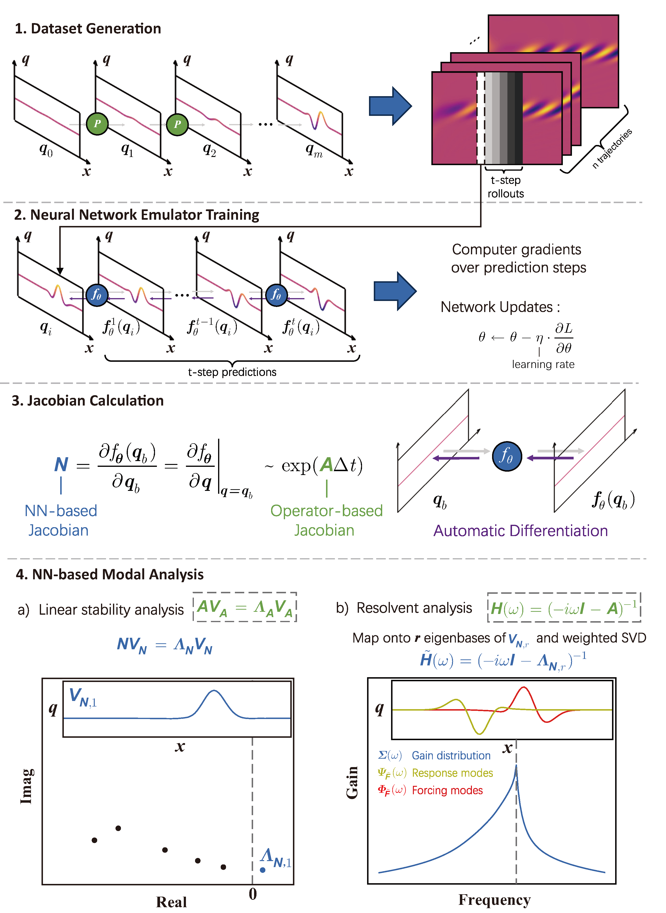

# A neural operator framework for data-driven discovery of stability and receptivity in physical systems

<div align="center">
[Paper](https://www.pnas.org/doi/10.1073/pnas.2526451123)  • 
[ArXiv](https://arxiv.org/abs/2604.19465)  • 
[Hugging Face](https://huggingface.co/datasets/jiatingdaole1109/NonlinearRA/tree/main) 

</div>

<p align="center">
  
</p>

*Data-driven algorithm workflow: (1) Collect trajectory snapshots, (2) Train NN emulator, (3) Extract Jacobian via automatic differentiation, (4) Perform modal analysis*

Understanding how complex systems evlove and respond to perturbations is fundamental across science and engineering. This work introduces a data-driven framework that automatically identifies stability properties and optimal forcing responses from observation data alone, without requiring governing equations.

## 📊 Methodology Overview
 
Our approach bridges the gap between data-driven and operator-based methods by:
 
1. **Training neural emulators** on trajectory data to learn nonlinear dynamics
2. **Computing local Jacobians** via automatic differentiation at any state
3. **Extracting stability modes** through eigenvalue decomposition
4. **Identifying optimal forcings** via resolvent analysis

The key relationship: `N ≈ exp(A∆t)` where `N` is the **NN-based dicrete-time Jacobian** and `A` is the **operator-based continuous-time Jacobian**.
 

## 🛠 Installation
 
```bash
# Clone the repository
git clone https://github.com/tum-pbs/NonlinearRA.git
cd NonlinearRA
 
# Create conda environment
conda create -n NonlinearRA python=3.12
conda activate NonlinearRA
 
# Install dependencies
pip install -r requirements.txt
```

## 📚 Usage Instructions
 
See the README in each case folder for specific usage:

- [`lorenz/README.md`](lorenz/README.md) - Lorenz system examples
- [`channel2D/README.md`](channel2D/README.md) - 2D channel flow examples

**Note**: Only Lorenz and 2D channel flow cases are provided here. More complex examples (Complex Ginzburg-Landau, reduced 3D channel flow) are available upon request from the author.

## 🎓 Citation
 
If you use this code in your research, please cite:
 
```bibtex
@article{
doi:10.1073/pnas.2526451123,
author = {Chengyun Wang  and Liwei Chen  and Nils Thuerey },
title = {A neural operator framework for data-driven discovery of stability and receptivity in physical systems},
journal = {Proceedings of the National Academy of Sciences},
volume = {123},
number = {42},
pages = {e2526451123},
year = {2026},
doi = {10.1073/pnas.2526451123},
URL = {https://www.pnas.org/doi/abs/10.1073/pnas.2526451123}}
```

## 📧 Contact
 
- **Chengyun Wang**: [chengyun.wang@tum.de](chengyun.wang@tum.de)
- **Nils Thürey**: [nils.thuerey@tum.de](nils.thuerey@tum.de)


## 📄 License

This repository is released under the license provided in `LICENSE`.

